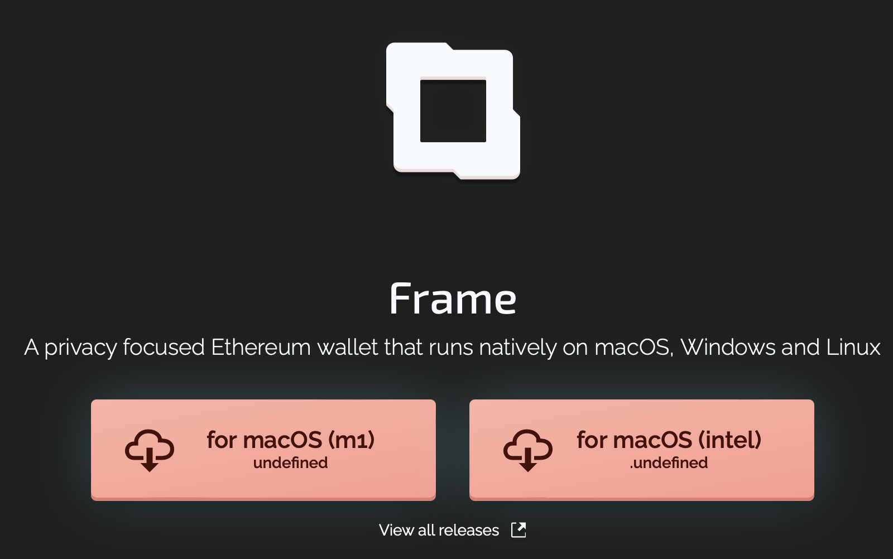
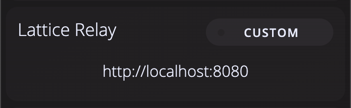

# Lattice Connect V2


# 👋 Introduction

By default, [Lattice1](https://gridplus.io/lattice) devices are configured to use GridPlus' cloud services to connect apps and route messages. However, **Lattice Connect V2** allows you to disconnect your Lattice1 from the GridPlus cloud and run the services locally instead. Note that your Lattice1 still needs to be on your WiFi network in order to route local messages, as Lattice Connect V2 runs on your computer and thus must connect to your Lattice1 over LAN.

This open-source project provides [Lattice1](https://gridplus.io/lattice) owners a HTTP server which they manage themselves, and that will proxy all messages between the device over their own local network, as an alternative to relying on the vendor-provided routing service. 

By default, communication between apps and a Lattice1 route through cloud infrastructure provided by [GridPlus](https://gridplus.io). Any messages sent to, and from, your device will always be encrypted and remain secure; however, we believe Lattice1 owners should be able to manage this service themselves, if they so choose.

### 🔗 Related Links
 - [📢 Discord](https://twitter.com/gridplus)
 - [🐤 Twitter](https://discord.gg/Bt5fVDTJb9)
 - [📚 Knowledge Base](https://docs.gridplus.io)
&nbsp;

## 🤔 Why use Lattice Connect?

Running _Lattice Connect_ yourself provides several advantages:

 - Doesn't requires running an external MQTT broker (compared to `v1`);
 - Offers the fastest message routing possible for a Lattice1;
 - Provides the highest amount of privacy available while using a Lattice1
 - Zero configuration changes required (i.e., no SSH'ing necessary);
 - Setup takes less than 5 minutes!

## 🚨 What about `v1`?
This project replaces the original _[lattice-connect](https://github.com/GridPlus/lattice-connect)_, which is now archived. 

At the time of release, the previous software should continue working as-is; however, GridPlus will no longer offer technical support, or otherwise provide maintenance for the prior version. Thus, breaking changes that may occur as we continue improving our customers' user experience should be expected, and switching to `v2` as soon as possible is highly recommended.

# 📂 Project Structure

The project follows a standard Express.js architecture with clear separation of concerns:

```
src/
├── controllers/        # Business logic for handling requests
│   ├── gridplus.controller.ts    # GridPlus provider controller
│   ├── provision.controller.ts   # User provisioning controller
│   └── signing.controller.ts     # Signing requests controller
├── middleware/         # Express middleware
│   ├── validate.ts     # Request validation middleware
│   └── websocket.ts    # WebSocket handling middleware
├── routes/             # API route definitions
│   ├── gridplus.routes.ts   # GridPlus related routes
│   ├── index.ts             # Main router that combines all routes
│   ├── provision.routes.ts  # User provisioning routes
│   └── signing.routes.ts    # Signing request routes
├── services/           # Business logic services
│   └── handlers/       # Handlers for different protocol operations
├── clients/            # API clients for external services
├── types/              # TypeScript type definitions
└── utils/              # Utility functions
```

## API Routes

- **GET /status**: Health check endpoint
- **/signing/:deviceId**: Handle signing requests
- **/provision**: User provisioning
- **/gridplus/connect**: Connect to a GridPlus device
- **/gridplus/:deviceId/method**: Execute blockchain methods

# 🧪 Testing

## Unit Tests (Jest)

Unit tests validate individual components in isolation:

```bash
# Run unit tests
yarn test

# Run integration tests
yarn test:int

# Run all unit and integration tests
yarn test:all
```

## End-to-End Testing (Vitest)

The project includes comprehensive end-to-end (e2e) tests to verify overall system functionality. These tests use Vitest for improved performance and developer experience.

```bash
# Run all e2e tests
yarn test:e2e

# Run specific test suites
yarn test:e2e:api
yarn test:e2e:errors
yarn test:e2e:websocket

# Run tests with UI
yarn test:e2e:ui

# Run tests in watch mode
yarn test:e2e:watch
```

### E2E Test Structure

- **API Tests**: Basic functionality tests for main API endpoints
- **Error Handling**: Tests for error conditions and edge cases
- **WebSocket Tests**: Tests for WebSocket connections and events

For more details about the migration from Jest to Vitest, see [E2E Vitest Migration Guide](e2e/VITEST-MIGRATION.md).

# ⌛️ Setup Guide

##### Estimated Time (TOTAL): 5–10 minutes

It's possible to run the server:

 - directly on a host system using `node` v14+; or,
 - through a `Docker` container.

### System Requirements

Besides the runtime requirements, the system resources for the proxy server are trivial. It will work on any system which can run Node v14+, or Docker.

The server has been tested on:

 - macOS v10.12;
 - Ubuntu 18.04;
 - Windows 10

## ⚙️ Configuring

#### 1️⃣ Get the source code
Clone the repo to the server or computer you plan to run it on:

 ```sh
 # Clone the repo:
$ git clone https://github.com/GridPlus/lattice-connect-v2.git

# Change your working directory to the project folder:
$ cd lattice-connect-v2
```

#### 2️⃣ Configure the environment
Edit `.env` and set your device's hostname: 

```sh
# - Open the '.env' file; then,
# - Replace this with your device's hostname 
ADMIN_CLIENT_HOST=http://GridPlus-xxxxxxxxxxx.local 
```
##### 🔍 Checking your device's hostname
On Firmware v16, and above, the device's hostname is shown with the following steps:

 1. **Unlock** the device; then,
 2. Tap **System Preferences**; then,
 3. Tap **Device Info**; then,
 4. See `SSH Host`.

## 🌐 Start Server: Using Node
From the project root folder, run: 

```sh
# Install dependencies
$ yarn install

# Start the server in development mode
$ yarn dev

# For production, build and start
$ yarn build
$ yarn start

# Look for confirmation...
... Worker 1 listening on port 8080
```

## 🐳 Start Server: Using Docker
From inside the project root folder, run:

```bash
# Build and start the containers
$ yarn docker:build
$ yarn docker:up

# Check logs
$ yarn docker:logs
```

## 🔬 Troubleshooting 

If the server fails to connect:

 - Double-check your `ADMIN_CLIENT_HOST` value;
 - Ensure `.local` is included as a suffix on the host;
 - `ping` your device, being certain your device is reachable before trying to run this software;
 - use the Lattice1 IP address as an alternative to hostname (see below);
 - be sure your network's firewall isn't blocking port 1883.
 
### Using IP Address
For many of the most common network setups, the server should have no trouble finding, and connecting, to the Lattice<sup>1</sup>. However, if it's unable to connect—and you're certain you've inputted the `<HOSTNAME>.local` correct—use the device's IP address instead:

```sh
# - Open the '.env' file; then,
# - Replace this with your device's IP address.
# - DON'T include '.local'; it's standard IPv4 format.
ADMIN_CLIENT_HOST=http://<IP_ADDRESS>
```

> _**NOTE:** The IP address of the device can be determined from your network's main router or gateway appliance. Details on how to do this vary depending on your specific router or gateway appliance, and is outside the scope of this document._

# ✌️ Disconnecting Entirely from the GridPlus Cloud

If you are using Lattice Connect V2 to route messages, your device will not use the GridPlus cloud, but will still be connected to it. If you would like to remove **all** connections to the GridPlus cloud, you will also need to erase some system settings and configure a custom device ID. Note that if you choose to do this, you will need to re-connect with all of your apps using the new device ID.

1. SSH into the Lattice (you can find credentials in `System Preferences -> Device Info` -- format the request like so: `ssh root@<SSH Host>.local`)
2. Stop current processes: `service gpd stop && service mosquitto stop`
3. Update credentials<sup>&dagger;</sup>: `uci set gridplus.provisionLatticeAPIURL="" && uci set gridplus.deviceID="ABCDEF" && uci set gridplus.remote_mqtt_address="foo" && uci commit`
4. Restart processes: `service gpd restart && service mosquitto restart`

Give it ~30 seconds and view the `Device ID` on your Lattice menu. You should see the device ID you just configured -- this new device ID indicates that you have disconnected your Lattice from GridPlus cloud services.

<sup>&dagger;</sup> Note that you can set whatever `deviceID` credential you want, but you should probably use six characters to avoid any edge cases. Also note that `remote_mqtt_address` is not used when Lattice Connect V2 is routing messages, but it can't be empty or else `mosquitto` will fail to start.

# 🔗 Connecting to Third Party Apps

Now that Lattice Connect V2 is running on your computer, you will need to update your connections to third party apps, which may involve removing the Permission on your Lattice1 device. This section covers the most common connections: [MetaMask](https://metamask.io) and [Frame](https://frame.sh).

## 🖼 MetaMask

Download the [MetaMask](https://metamask.io) extension if you don't have it already.

#### Set the Lattice Relay

1. Start by removing all **Lattice1** accounts from MetaMask if present.


3. Remove the MetaMask permission from your Lattice1 if present.
4. Log into the [Lattice Manager](https://lattice.gridplus.io) and remove any MetaMask entries from the **3rd Party Connections** list if present. 


5. In the **Settings** tab input the `http://<RELAY_HOST>:8080` into the **Connection Endpoint** field.

Replace `<RELAY_HOST>` with the host running _Lattice Connect_.
When running _Lattice Connect_ on the same computer you are using MetaMask, use `localhost`, otherwise use `http://<IP address>:8080` where `<IP address>` is the IP of the machine running **Lattice Connect**.


6. Connect your Lattice to MetaMask as normal. Transaction requests will now be routed to your self-hosted endpoint.


## 🖼 Frame Wallet



 Download [Frame](https://frame.sh) wallet desktop app, and run the installer.

#### Set the Lattice Relay

From the _Settings_ panel (upper-right; slider icon):

 - Scroll down to the **Lattice Relay** option; then,
 - Click _Default_; switch to _Custom_; then,
 - Input the `http://<RELAY_HOST>:8080`

Replace `RELAY_HOST` with the host running _Lattice Connect_.
When running _Frame_ and _Lattice Connect_ on the same computer, use `localhost`:



## FAQ

### What do I need to do to migrate from `v1`?
Nothing. If you've made changes from `SSH`, they will be ignored by `v2`. 

If you're adament about having factory settings, you may reset your router in the Lattice1 System Settings. Please be aware doing this will also reset your wireless routing settings, and will require reconnecting to your Wi-Fi network.

### How do I connect more than one Lattice1?
Currently, the direct method supports a single Lattice1 at a time.

## Docker Setup

Lattice Connect Server can be run with Docker Compose, which sets up both the MQTT broker and the Node.js application server.

### Prerequisites

- Docker and Docker Compose installed
- Node.js and Yarn installed (for local development)

### Running the Services

To start both the MQTT broker and application server:

```bash
# Build and start the containers
yarn docker:build
yarn docker:up

# Check logs
yarn docker:logs

# Stop services
yarn docker:down
```

### Testing the Setup

We provide scripts to verify the Docker setup:

```bash
# Test if services are running properly
yarn docker:test

# Test MQTT connectivity specifically
yarn mqtt:test
```

### Integration Tests

Integration tests use a dedicated Docker Compose configuration:

```bash
# Run integration tests (will start test containers automatically)
yarn test:integration
```

### Configuration

The Docker environment uses environment variables from your `.env` file. Inside Docker containers, services communicate over the Docker network:

- MQTT broker is accessible at hostname `mqtt` 
- Default ports: MQTT (1883), App Server (8080)

You can customize these settings in your `.env` file or by providing environment variables when starting the containers.

### Development Workflow

For development, you can:

1. Run only the MQTT broker in Docker: `yarn docker:mqtt:up`
2. Run the app locally: `yarn dev`

This allows you to make changes to the code without rebuilding Docker containers.

## Contributing

Contributions are welcome! Please follow the standard GitHub workflow:

1. Fork the repository
2. Create a feature branch
3. Make your changes
4. Submit a pull request

### Development Guidelines

- Follow the Express.js architecture pattern
- Add appropriate TypeScript types
- Write tests for new functionality
- Format code with Prettier before submitting

## Client Examples

For client applications connecting to `lattice-connect-v2`, you can find working TypeScript examples in the [`lattice-client-examples`](./lattice-client-examples) directory:

- **SDK-based Client**: Uses the `gridplus-sdk` library to connect to a Lattice1 device through lattice-connect-v2
- **Direct API Client**: Communicates directly with the lattice-connect-v2 REST API

Each example demonstrates how to connect to a device, pair with it (if needed), fetch addresses, and sign Ethereum transactions. See the [examples README](./lattice-client-examples/README.md) for more details.
